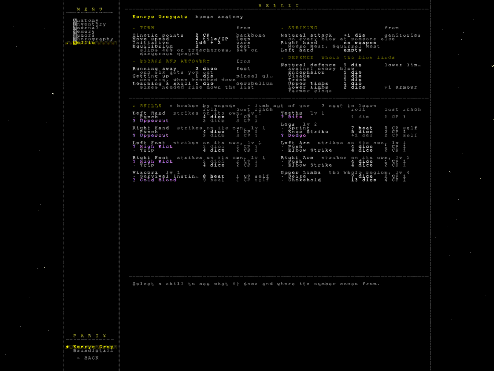
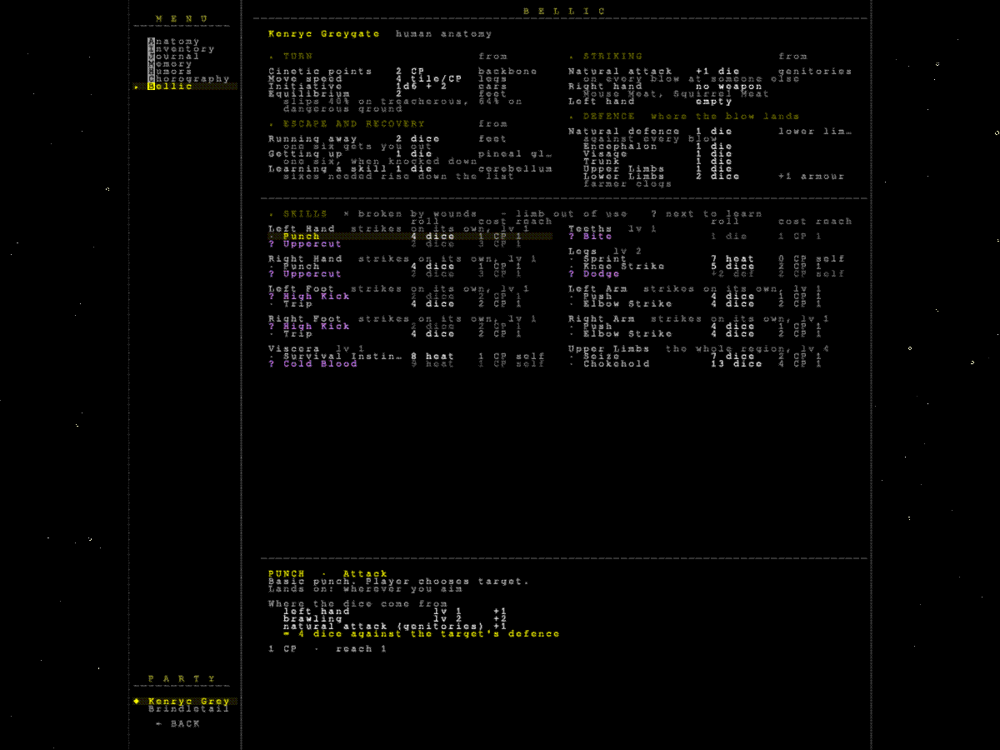
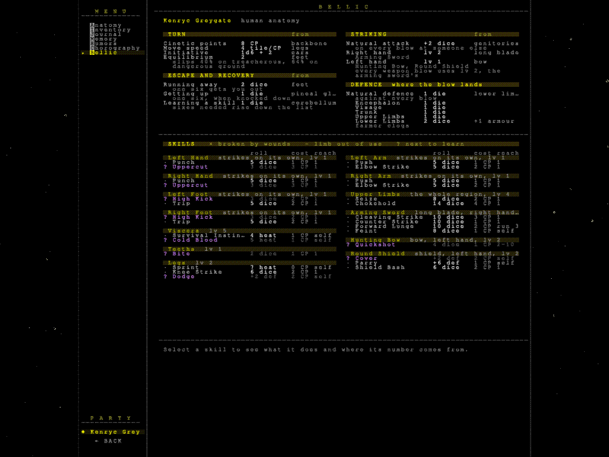
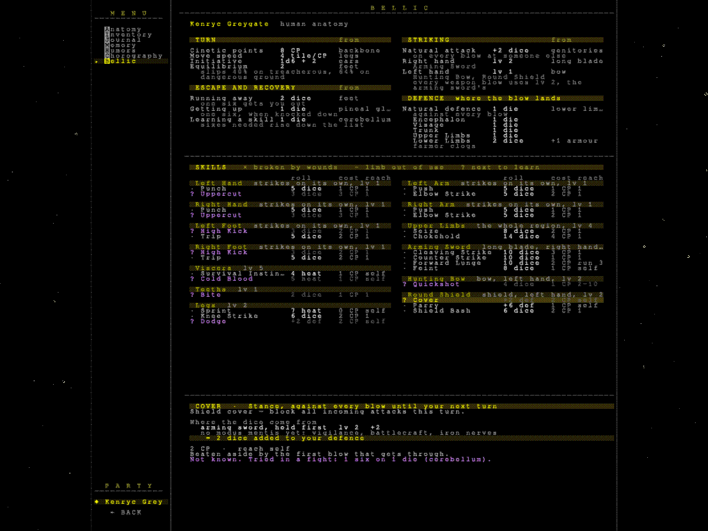
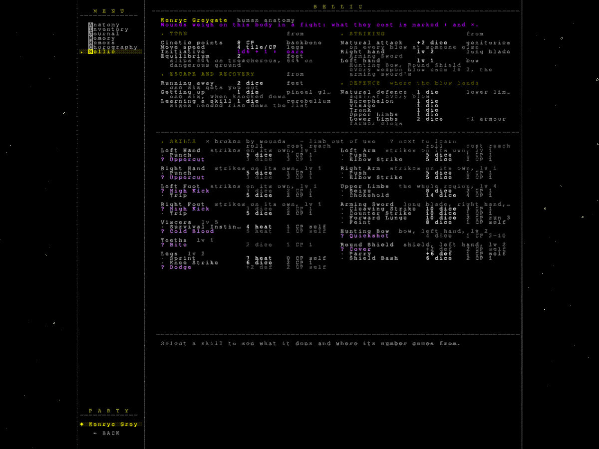
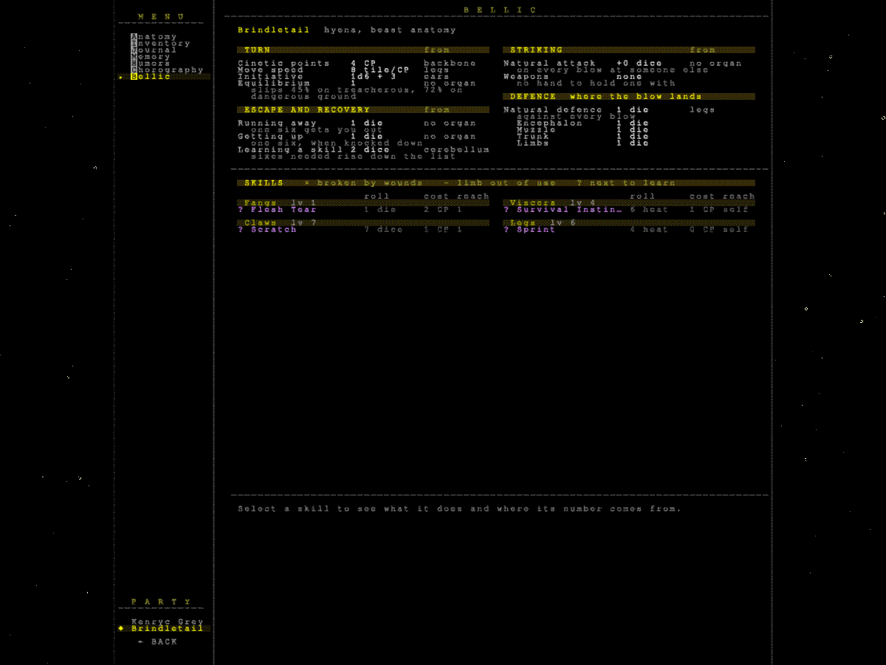

# Report: the Bellic and Journal tabs

Branch `feature/bellic-journal`, cut from `develop`. Not merged, not released. The repository in this
session has **no remote configured** (`git remote -v` is empty), so the branch could not be pushed: it
exists in the session's clone only.

## Setup

`tools/linux/cloud-setup.sh` ran clean (.NET 8.0.132, llama.cpp b11515 Ubuntu x64 CPU, Mesa llvmpipe
under Xvfb). `fetch-assets.sh --model` fetched and verified `models/model.gguf`. **The GloVe download
from nlp.stanford.edu was reset by the network twice**; the same `glove.6B.zip` came from the Hugging
Face mirror (`stanfordnlp/glove`). Its extracted `glove.6B.100d.txt` hashes
`be4367dd…` where `models/README.md` records `95dde4df…` — the README already says that hash is of a
local copy and unconfirmed upstream (line endings would explain it). Baseline audits: 13 of 13 passed.

## Part 1: Bellic

Commit `3bd520f`. A new management tab, key **B**, for every party member — information only.

### What a fight reads from a party member (from `src/fight/`), and what the tab keeps

| read by the fight | where | on Bellic? |
|---|---|---|
| cinetic points (backbone), move speed (legs; doubled by Sprint) | `Fighter`, `CombatStats` | yes — TURN |
| initiative (ears, rolled 1d6 + it), equilibrium (feet → slip risk on treacherous/dangerous ground) | `FightModeAdapter`, `FightResolver.EstimateSlipRiskPct` | yes — TURN |
| runaway dice (feet), knockdown recovery (pineal gland), fight-learning dice (cerebellum) | `RunawayAction`, `FightModeAdapter`, `LearnSkillAction` | yes — ESCAPE AND RECOVERY |
| natural attack (genitories), weapons held per hand, weapon level (the **first** weapon held, right before left) | `SkillAction`, `FightingMedium.GetLevel` | yes — STRIKING |
| natural defence (lower limbs; a beast's legs), armour dice per body section and the garments behind them | `SkillAction`, `PartyMember.ArmorDiceForSection` | yes — DEFENCE, the pool per section |
| known skills per medium (organ, organ part that strikes alone, body region, weapon), broken by wounds, limb disabled by a High wound, next to learn | `FightingSkill.IsUnlocked/IsBrokenFor/IsAnyMediumAvailable`, `Fighter.GetLearnableSkills` | yes — SKILLS |
| a skill's dice (medium × mult + **effective** modus mentis levels × mult + base, + natural attack against another), CP, range/min range/charge, buff heat (10 − level, ≥ 1), guard dice, wound target, effects on hit, riposte gate, sixes needed to learn | `FightingSkill`, `FightBuffEffects`, `FightStatusEffect` | yes — the row, and the expanded panel on click |
| HP, wounds, organ scores | | **no** — Anatomy |
| a garment's own defence, a weapon's own level and the attacks it unlocks | | **no** — Inventory item panel |
| vital heat | | **no** — Humors |
| AI personality | `FightAI`, `AiPersonality` | **no** — enemies only |
| active status effects | `Fighter.ActiveEffects` | **no** — they exist only during a fight |

Anatomy's hovered-organ stats call `GetRawValue` (wounds ignored); the fight calls `GetValue`. Bellic shows the
fight's value and marks a wounded one ↓, so a player can see what a wound costs at the table.

### Screens

The four cases asked for, each checked by eye from a `snap`:

| | |
|---|---|
| human, unarmed |  |
| human, a skill expanded (Punch: where its 4 dice come from) |  |
| human, armed (sword right, shield and bow left) |  |
| armed, Cover expanded |  |
| wounded (initiative ↓ from an ear wound) |  |
| beast companion (hyena: fangs, claws; no hands to hold a weapon) |  |

`cli/system/bellic_tab.cli` (protagonist and beast companion) and `bellic_armed_wounded.cli`. New CLI:
`manage Bellic <skill>`, `manage member <name|slot>`.

**Found on the way, not fixed:** `--weapons` equips the arming sword twice (`AcquireItem` already put it in the
right hand, then `Equip` adds it again), so the fight shows two identical sword tabs. Bellic lists one item once.

## Part 2: Journal

Commits `c2ba2d2` (capture and display), `ed00fa4` (chronicler and gate), `3598827` (the configuration chosen).

### Design

- **Entries.** `Protagonist.Journal` holds `JournalEntry` records: kind (narration, dialogue, fact, milestone),
  day, place, area, acting member (and whether a companion), source text, written paragraph, state (raw → pending →
  written), visit group. Saved as plain data in `PartyState.Journal`, copied not shared; `SaveAudit` updated; save
  version 9.
- **Capture, where each thing is finalised**, all through `JournalRecorder`: narration on
  `NarrationScrollBuffer.BlockAdded` (fires only on commit, so a reset preview never reaches it), credited to whoever
  is acting at that moment, which keeps a Speak About hand-off right; NPC lines from the same event, named by the label
  the player knows; the reply picked in `OnOptionSelected` (never the options left); chips with `ShowInUI`, minus
  the bookkeeping ones by type (practice, grant, spent noetic point, wound — the last two are milestones); milestones at
  the events: a lesson (party only, once per member and modus mentis), a wound in a fight or from a penalty, a healing,
  a companion joined, dead or parted with, a first visit (keyed by vertex), a fight won or fled.
- **Display.** The Journal tab: one list, opening at the newest entry, a header at each change of day or place,
  milestones as short marked lines, a companion's passages marked down the left edge, wheel and Page Up/Down. A visit
  not yet written up shows its raw entries.
- **The queue.** Entering the world map closes the visit's group; its entries turn pending. That state *is* the queue,
  so saving the entries saves it and a quit loses nothing.
- **The chronicler.** `Chronicler`, pumped each frame, takes the oldest pending visit and asks for one paragraph
  through `LlamaServerManager.GenerateBackgroundAsync`; the paragraph is applied on the game thread. Prompts in
  `ChroniclerPrompt`.
- **The gate, in `LlamaServerManager`.** Every request is foreground unless it came through
  `GenerateBackgroundAsync`. A foreground request cancels a running background one at once; a background one starts
  after 4 s of foreground silence; a cancelled job returns null, keeps nothing and starts again later. Background
  prompts are **prefilled in small steps** (64 characters, pinned to the server's last slot), because llama-server only
  drops a cancelled request between batches (see the measurements). Every request writes an `[llm-timing]` line to
  `log.txt`; the crash report has an "LLM priority gate" section with the counters.

### Save size

Measured on the twelve visits collected: a visit's raw entries are 3.7 KB of JSON at the median, 21 KB at most
(a long conversation, before bookkeeping chips were dropped). **Kept in the save, compacted and capped:** once written,
a visit keeps only the entry carrying its paragraph (~0.8 KB) and its milestones (~0.25 KB each, 1–2 a visit), about
**1.5 KB a visit — roughly 450 KB over a 300-visit run**. Visits not yet written keep at most 200,000 characters of
narration source between them (oldest dropped first, facts and milestones kept), so a run whose chronicler never runs
(no model, or a player outpacing it) is bounded too. Moving it out of the save would buy nothing the cap does not, and
would split one run across two files that must agree.

### Speed

**Measured on this cloud machine: 4 cores (AVX-512), llama-server at `-t 4`, CPU only, the game itself (software
OpenGL) sharing the same 4 cores.** Prompt processing ran at ~40 tokens/s, generation at ~3 tokens/s.
`tools/journal/latency.cli`: one scripted run (seed 42, `--llm-seed 7`), two visits, reading pauses that let the
chronicler start and clicks that then preempt it, played with and without `--no-chronicler`. The seeded sampler makes
both runs ask the same 28 foreground questions in the same order, so they pair one to one.

| round | what changed | foreground requests that preempted a job | their extra wait | everything else |
|---|---|---|---|---|
| 1 | gate only, prompt sent whole | 4 | **~9 300 ms** on the one caught in its prefill, ~600 ms caught while generating | — |
| 2 | prefill in 160-character steps | 3 | 889, 1 724, 1 792 ms | median 76 ms against 78 without |
| 3 | prefill in 64-character steps (**shipped**) | 3 | 158, 598, 1 283 ms | median 64 ms against 67 without |

Round 3 in full (`python3 tools/journal/latency.py`):

```
WITH chronicler: 28 foreground (17 streamed), 6 background (2 ok, 4 preempted)
   stream ttft ms: median 6713  mean 8221  max 27500
   total ms:       median 12948  mean 14976  sum 419s
   queued ms (total − server prompt − server gen): median 64  mean 702  max 15991
   foreground requests that preempted a background job: 3, its release took 680 ms mean, 1283 max
WITHOUT chronicler: 28 foreground (17 streamed), 0 background (0 ok, 0 preempted)
   stream ttft ms: median 6635  mean 7511  max 17714
   total ms:       median 13259  mean 14384  sum 403s
   queued ms (total − server prompt − server gen): median 67  mean 288  max 6133
   foreground requests that preempted a background job: 0

Paired by order (28 pairs; a pair whose prompt sizes differ is marked *):
 #  kind    prompt_n w/o   ttft w/o (ms)     total w/o (ms)     cache_n w/o   bg_delay  queued w/o
 1  stream    237   237    27500   17714     51492    40353    205   205       0   15991   6133
 2  oneshot   110   110       -1      -1      3245     3585    218   218       0      95     94
 3  stream    314   314     7703    7785     19275    19788    219   219       0      62     59
 4  oneshot   284   284       -1      -1      7123     7321    225   225       0      58     71
 5  oneshot   207   207       -1      -1      5910     5892    239   239       0      64     70
 6  stream    306   307     7927    7912     34585    31598    338   338       0      63     65
 7  oneshot   198   192       -1      -1      5282     4909    248   248       0      62     79
 8* stream    253   243     6492    6501     13066    14054    247   219       0      58     63
 9* stream    229   231     6032    6434     21035    13085    261   219       0      63    143
10  stream    246   246     6375    6230     11006    10749    288   288       0      45     47
11  oneshot   174   174       -1      -1      4731     4928    210   210       0      70     96
12  stream    266   266     6713    7097     12632    12645    221   221       0      59    109
13  stream    306   311     7963    7658     27361    32599    224   219       0      74     68
14  stream    223   223     7382    6114     16248    16501    219   219    1283    1283     94
15  oneshot     1     1       -1      -1       478      311    327   327       0      64     59
16  stream    314   314     8052    8041     28816    18959    219   219       0      59     61
17  oneshot   165   165       -1      -1      5071     4975    344   344     158     158     74
18  oneshot    96    96       -1      -1      3399     3183    353   353       0     105     74
19  stream    224   224     6726    6375     33029    38774    423   423       0      70     66
20  stream    226   241     5959    6635     17504    16801    262   247       0      70     47
21  oneshot    23    23       -1      -1      1491     1456    389   389       0      68     91
22  stream    227   227     6407    6509     18551    20607    352   352       0      65     61
23  stream    231   231     6636    6082     21601    19078    352   352       0      50     50
24  oneshot   190    99       -1      -1      5101     3293    253   344       0     103     63
25  stream    246   245     6619    6645     12829    13433    219   220       0      59     68
26  stream    231   231     6711    5819     14297    19653    219   219     598     598     62
27  oneshot   166   166       -1      -1      4682     4659    223   223       0      71     53
28  stream    327   327     8560    8132     19493    19555    270   270       0      61     57

Matched pairs: total time with − without: median +20 ms, mean +370 ms
Matched streamed pairs: ttft with − without: median +145 ms, mean +832 ms
```

Pair 1 is the run's first request, made before any background job existed; its difference is start-up noise (word
vectors loading on the same cores). Pairs marked * differ in prompt size because the server's prompt cache held
different things.

**Verdict against the pass bar — not met in full.** No foreground request is slower *except* the ones that land on a
running chronicler job: three in 28 here, which waited 0.16–1.3 s extra. That residue is the server finishing the
batch it was in when the stream closed. It scales with prompt-processing speed, so it shrinks on a faster CPU, but it
cannot reach zero with this design. What remains to try, in order: a smaller step still (32 characters; the job gets
slower, the foreground does not); a longer quiet delay (fewer preemptions, slower journal); generating with
`n_predict` chunks so decoding also yields; or giving the chronicler only a player's longest pauses (menus, the map).

**llama-server settings: unchanged, so no new memory cost.** This build already runs `--parallel` auto (4 slots) with a
unified KV cache over `-c 2048` and keeps idle slots' prompts in host RAM (`--cache-ram`, 8 GiB ceiling; ~190 MiB in
use in these runs). The feared eviction does not happen in practice: after a chronicler job the narrator's requests
still reused their cached prefix (`cache_n` identical with and without the chronicler in every matched pair). The
only server-facing change is per request: background jobs set `id_slot` to the last slot.

**The chronicler is slow on this machine**: a 140-token paragraph takes ~40 s of generation, so it completes only in a
long pause (the measured run had to hold 240 s at the end). On a player's machine that is the number to watch.

### Quality

`tools/journal/`: `collect.py` played eight scripted runs on the real model (`--no-chronicler`) and dumped their
journals (committed in `tools/journal/material/`); the game renders every prompt variant from them
(`--journal-prompts`, so the harness holds no copy of a prompt); `bench.py` generates; `score.py` scores.
**Material: 12 visits, 39 events, 12 days** — quiet visits, a failure, a wound, a beast, a party, a fight on the road,
two conversations. **Gap:** no recruitment (the model never chose to tame the wolf it was pinned to), and companions
never took the narration.

Automated checks per paragraph: proper names absent from the notes, share of milestones mentioned, share of 6-grams
copied from the notes, share of 4-grams repeated from the previous paragraph, person of the voice, length. Manual, by
reading, 1–5: fidelity / coverage / readability / voice (rubric in `tools/journal/README.md`; scores in
`manual_scores.json`, for the voice axis).

| axis | variant | n | invented names | milestones covered | copied | repeated | voice held | words | manual f/c/r/v | prompt tok | gen tok | s/job |
|---|---|---|---|---|---|---|---|---|---|---|---|---|
| first default | diary, everything, previous paragraph, 160 | 12 | 0.17 | 0.48 | 0.34 | 0.24 | 1.00 | 110 | 4.2/3.2/3.0/3.2 | 516 | 151 | 24.0 |
| voice | chronicle (3rd person) | 12 | 0.08 | 0.60 | 0.15 | 0.12 | 1.00 | 88 | 4.4/3.4/3.6/4.3 | 507 | 146 | 23.3 |
| voice | diary tinted by feelings | 12 | 0.00 | 0.47 | 0.21 | 0.58 | 0.83 | 111 | 4.0/3.2/3.1/3.2 | 516 | 152 | 24.1 |
| voice | campaign log | 12 | 0.17 | 0.38 | 0.12 | 0.00 | 0.92 | 65 | 4.1/3.3/3.2/3.7 | 496 | 103 | 18.3 |
| inputs | milestones only | 12 | 0.00 | 0.86 | 0.00 | 0.61 | 0.83 | 85 | — (read: invents the visit) | 120 | 107 | 12.6 |
| inputs | facts and milestones | 12 | 0.00 | 0.79 | 0.00 | 0.34 | 1.00 | 70 | — (read: invents; 2 empty) | 191 | 116 | 14.6 |
| inputs | narration only | 12 | 0.00 | 0.51 | 0.42 | 0.53 | 1.00 | 113 | — | 432 | 151 | 22.1 |
| grouping | one event | 39 | 0.00 | 0.39 | 0.17 | 0.45 | 0.79 | 104 | — | 269 | 144 | 19.0 |
| grouping | one day | 12 | 0.17 | 0.14 | 0.46 | 0.27 | 0.92 | 116 | — | 411 | 156 | 22.7 |
| memory | none | 12 | 0.08 | 0.45 | 0.36 | 0.04 | 0.92 | 113 | — | 430 | 149 | 21.6 |
| memory | rolling summary (+1 request) | 12 | 0.08 | 0.37 | 0.27 | 0.02 | 0.83 | 103 | — | 344 | 196 | 24.6 |
| length | 90 tokens | 12 | 0.08 | 0.31 | 0.28 | 0.36 | 1.00 | 63 | — | 181 | 90 | 11.8 |
| length | 260 tokens | 12 | 0.08 | 0.52 | 0.26 | 0.54 | 1.00 | 144 | — | 182 | 181 | 21.3 |
| **shipped** | **chronicle, everything (bookkeeping dropped), no memory, 140** | 12 | **0.00** | **0.54** | **0.15** | **0.09** | **1.00** | **89** | **4.3/3.6/3.8/4.7** | 438 | 131 | 20.2 |

Read alongside the numbers, which miss things both ways:
- **Milestones or facts alone are the worst inputs, despite their coverage scores.** Given "Learned musk reading" and
  little else, the model wrote a visit that never happened — merchants measuring musk, a reeve explaining trade, an axe
  through a hedgerow, a bearded reeve at a gate. No proper name, so the automated check passes it.
- **The previous paragraph as memory is copied forward**, sometimes a whole closing sentence into the next visit
  (road fight, visit 4). Tinted diary was worst (58%). No memory cost nothing and repeated least.
- **The diary voice** kept opening "Ernaeulht the White wrote in his diary:" and drifting into the third person.
- **The bookkeeping chips** came back as "gaining two more experience points" and "noetic point decreased by one" in
  every voice; they are no longer recorded as facts (the shipped row was measured with them filtered out of the same
  material).
- **Still wrong in the shipped configuration:** it paraphrases more than it condenses (the notes themselves are the
  3B narrator's florid prose); one paragraph in twelve invents detail (the brewer's "simple garments of wool", "a
  leather pouch") and slips a pronoun; one copies an "I" from a note into third person. Names the player has not been
  told can reach it through a chip (`Conversation: Aeemilyus`) — that chip leaks the name on screen already.

**Chosen:** third-person chronicle, everything recorded except bookkeeping, a visit per paragraph, no memory, 140 tokens.

#### Events, not musings (follow-up)

Read in play, the paragraphs told the character's observations and thoughts and let the events slip. The
notes explained it: observations were a third of the items and the longest, thoughts another third, and the
"DID" items were the acting mind's florid telling of an act ("I search the pool for food, not to stand and
stare") rather than the act. Changed, in `ChroniclerPrompt` and the recorder:

- **An act is recorded as what was tried and whether it worked.** The outcome block carries an
  `ActionAttempt` (the plain phrase the thinking chose, and the verdict), kept on the entry; the chronicler
  is told `FAILED TO: grab a rock.` with the first sentence of the telling. A refusal by a rule, or as
  impossible, carries one too. An outcome with no attempt — a mind turning a goal down — is left out.
- **Thoughts are left out; an observation is a one-sentence `SCENE`; a feeling reaches only the tinted diary.**
- **Lines go unquoted, first sentence only**, and the prompt asks for what was said in its own words: quoted
  whole, the conversation was copied out until the cap fell mid-quote.
- **The token cap follows the notes** (`TokensFor`: 40 + characters/6, between 50 and 140). With the
  observations gone a quiet visit was one setting line, and given 140 tokens the model invented a brewer, a
  reeve and two conversations to fill them. The prompt also says a quiet visit gets a sentence or two.

Measured on a fresh capture of the same eight scenarios (14 visits; now committed as the material), same
seed, both prompts rendered by the game:

| prompt | n | invented/para | coverage | copied | repeat | voice | words | prompt tok | gen tok | gen s/job |
|---|---|---|---|---|---|---|---|---|---|---|
| before | 14 | 0.07 | 0.50 | 0.14 | 0.03 | 0.86 | 90 | 392 | 136 | 18.9 |
| **after** | 14 | **0.00** | **0.63** | **0.09** | **0.03** | **0.86** | **49** | **210** | **73** | **9.7** |

Read beside the notes: every act now appears ("could not grab a rock", "failed to examine the gate bar
closely", "sat on the mounting block and let the time pass… waited until dawn", the introduction to the
brewer and what he answered), and quiet visits are one or two sentences with nothing added. Still wrong:
one conversation of two still quotes three lines; one paragraph in fourteen opens by copying the header
("Day 1, at the plain (hedgerow). Eghbert Moorshield is here."); the narrator's own oddities pass through
when they are the act ("his fingers as quick as shadows" for listening to a goose). Half the prompt and
half the generation also halve how long a preempted job can hold the server.

#### Six groups, raw input beside the paragraph (shipped configuration)

#### hall_dialogue, visit 2

<details><summary>Notes sent (676 prompt tokens)</summary>

```
- CHANGED: Conversation: Aeemilyus
- SAID by Aeemilyus: "Something you seek to know, indeed."
- SAID by Ernaeulht the White: "Speak of the folk we meet, how do they fare, and where do they come from?"
- SAID by Aeemilyus: "There be folk, scarce few, whom I well know."
- SAID by Ernaeulht the White: "Who here would ye believe in a lie?"
- SAID by Aeemilyus: "Two of them, indeed, and I'll wager you cannot guess which two to keep a vigilant eye upon."
- MILESTONE: Learned inquiry
- MILESTONE: Learned streetwise
- MILESTONE: Learned gossip
- MILESTONE: Learned lineage lore
- DID: You finished talking with Aeemilyus.
- SAW: I follow Aeemilyus, the brewer of the coast, as he taps a cask and sniffs the froth, brow furrowed in judgement. He is the only one in the room with nothing in front of them, already asking me something before I have finished arriving. I take careful note of what he is wearing and what he is carrying, recalling my own…
- THOUGHT: I question what he knows of his work and of this place, brow furrowed in judgement. What draws me is the welcoming and care of guests and travellers, already asking of what I am wearing and carrying, before I have finished arriving.
- DID: I found him at the edge of the courtyard, his eyes still wary but his body relaxed. With a gentle smile, I invited him closer, and as he sat, I noticed the way his hands trembled. It only stretched, but I knew there was always room. It felt right to sit with him, to listen to what he knew of his work and of this place.…
- CHANGED: Conversation: Aeemilyus
- SAID by Aeemilyus: "It seems you seek to learn much."
- SAID by Ernaeulht the White: "Speak of your tasks, let me hear of your labours."
- SAID by Aeemilyus: "In the ale, flavors of the earth do mingle, steeped in my hands and seasoned with years of care."
- SAID by Ernaeulht the White: "And what did they teach you, and where did you learn it?"
- SAID by Aeemilyus: "Wrong as I am, I yet teach a novice how I do this trade."
- MILESTONE: Learned brewcraft
- MILESTONE: Learned disputation
- DID: You finished talking with Aeemilyus.
- SAW: I follow Aeemilyus, the brewer of the coast, as he taps a cask and sniffs the froth, brow furrowed in judgement. Already asking me something before I have finished arriving, I take careful note of what he is wearing and carrying, a reflex from the violent storm when my legs gave out.
```
</details>

> Ernaeulht the White followed Aeemilyus, the brewer of the coast, as he tapped a cask and sniffed the froth, brow furrowed in judgement. Already asking her something before she had finished arriving, Ernaeulht took careful note of what Aeemilyus was wearing and carrying. Aeemilyus wore simple garments of wool, and in his hands he carried a leather pouch. Already wary, his hands trembled slightly as he sniffed the froth, a sign of his concern about the quality of the ale. Ernaeulht sat closer to him, offering a gentle smile as Aeemilyus sat down.

#### road_fight, visit 4

<details><summary>Notes sent (308 prompt tokens)</summary>

```
- MILESTONE: First came to the plain
- SAW: I find myself at noon in the village square, where my days spent at the stable now echo the foot-traffic crossing every direction. The well, the ways, the peat cut, and the mounting block still stand, their presence a silent reminder of lessons learned. I watch a well, a central stone-rimmed well at the square's heart,…
- THOUGHT: I spy a green edge, waterside, and threshing floor. To the orchard, I march, relying on sturdy arms and a hearty laugh to lighten the load.
- MILESTONE: Learned wayfaring
- DID: I made it to the orchard, the task done. Patience bore me through the weight, the journey clear as a steady toil.
- CHANGED: Moved to: Village Orchard
- SAW: I walk through the grass, the scent of the goat's breath heavy in my nose. My body tenses at the warning in its posture, a kinship to all creatures. The waterside whispers, the old man's hands warm and familiar, the forge's fire crackling, but my focus remains on the goat's flicked ear, a silent command. I catch the sc…
```
</details>

> At noon in the village square, Nyccolhoth Lhavyniwyn found himself surrounded by the foot-traffic echoing the days spent at the stable. The well stood at the square's heart, stone-rimmed and central, a silent reminder of lessons learned. Watching the well, he noted the green edge of waterside and the threshing floor, then marched to the orchard. Patience bore him through the weight, the journey clear as a steady toil. Now moved to the Village Orchard, Nyccolhoth's focus remained on the goat's flicked ear, a silent command.

#### coast_wound, visit 2

<details><summary>Notes sent (396 prompt tokens)</summary>

```
- MILESTONE: First came to the plain
- SAW: I find myself among the tide pools, a shelf of rock pitted with pools the tide leaves full, each a small world. Around me are marks of alleys, exits marked, a sand flat, a thicket of bramble, a crab, a pool, and a rocky shore. I notice a sound, the alley's racing between the shore and the rock, waves running through it…
- THOUGHT: I mark the sun-warmed slab of rock above the tideline. Dry and warm on its landward side, it beckons. I will rely on my skills to survive here, choosing each step with care.
- DID: I failed to heed the flat rock, lost the thread of thoughts, starved before night.
- SAW: I watch the water's edge, recalling how I once hid from looters, the salty breeze reminding me of those times spent by the port. I let my focus go, where once I'd watch for scraps on the street.
- THOUGHT: I mark the rock's edge, the salt-bright pool, and the anemones at the bottom. My intent is to examine closely, to stay alive here, to trust only the practical skill of this place.
- DID: I search the pool for food, not to stand and stare. Finds what keeps me, not what tastes nice.
- THOUGHT: I won't delve into the tide pool's secrets. That would be foolish, and I'll think on it again. I could seize a crab here. I'll use the street's harsh conditions to stay alive, marking the safe alleyways.
- DID: I missed a crab, starved now.
```
</details>

> On Day 1, Aentonyuz the Wild first came to the plain, among tide pools that served as a shelf of rock pitted with pools the tide leaves full. Around him were marks of alleys, exits marked, a sand flat, a thicket of bramble, a crab, and a pool. The traveller noticed a sound, the alley's racing between the shore and the rock, waves running through it. He marked the sun-warmed slab of rock above the tideline, dry and warm on its landward side, which beckoned him. Aentonyuz chose each step with care, relying on his skills to survive.

#### plain_quiet, visit 2

<details><summary>Notes sent (291 prompt tokens)</summary>

```
- MILESTONE: First came to the plain
- SAW: I find myself walking along the hedgerow, in the morning, as if I were a child playing in the same place, only now the thorns are a reminder of the long days spent gathering mushrooms. I shift my gaze to the hare, its long ears flat against the sandy ground as it breathes deeply, a parallel to my childhood days spent a…
- THOUGHT: I notice the long-eared sandy hare, its ears flat against its head, nose working the air. I want to breathe in the scent that comes with it, a simple pleasure of the land, and rely on the plain ways of country folk to guide me.
- DID: I stumbled in the scent of the hare, missed the thread of my thoughts. Soil crunched under my feet, wild thoughts scattered like seeds in a storm.
- SAW: I watch the blades of grass sway in the wind, a scene much like when I played among the fields, the sky above vast and unbroken, as it was when I used to imagine myself among the corpses looters left. I glance at a gate bar, recalling how my friends and I would play near the sagging five-bar gate with its top rail worn…
```
</details>

> On Day 1, at the plain (hedgerow), Eghbert Moorshield walked along the hedgerow as if he were a child playing in the same place. Thorns reminded him of long days spent gathering mushrooms, while a long-eared sandy hare flattened its ears against the sandy ground as it breathed deeply, a parallel to his childhood days. Eghbert noticed the scent of the hare, his thoughts scattered like seeds in a storm. Soil crunched under his feet as he stumbled in the scent. He glanced at a gate bar, recalling how his friends and he would play near the sagging five-bar gate with its top rail worn.

#### burg_party, visit 2

<details><summary>Notes sent (567 prompt tokens)</summary>

```
- MILESTONE: First came to the coast
- SAW: I find myself in the village square, afternoon's warm light casting shadows. A well, a goose, a mounting block, stocks and a wayside cross loom as they once did in my childhood at the stable. I was drawn to the ways leading on from the stable. A church walk, a cattle pen, and a threshing floor all felt familiar, like a…
- THOUGHT: I spy a white goose, his neck stretched wide in a hiss. The smell alone is worth the strain to keep walking, for a laugh in the day is better than weeping.
- MILESTONE: Learned musk reading
- DID: I have breathed in the scent of the goose, a musk that lingered in my breath. This success teaches me to be patient, for even the musk fades, leaving only the steady oak of my spirit.
- SAW: I catch the scent of alertness from the goose, a white head stretched wide as a warning. He stinks of fear, his neck twitching with the threat of flight. I turn to the mounting block, scenting the earth's dampness and the tension in the air, posture of the stone steps warning of a horse's ready charge. I let my focus g…
```
</details>

> In the square at the coast, Ghiulhiano Windhill found himself amidst familiar sights: a well, a goose, a mounting block, stocks, and a wayside cross. The scent of the white goose, his head stretched wide in a hiss, lingered in his breath. It was worth the strain to keep walking, for laughter in the day was better than weeping. The musk reading taught him patience, as even the musk of the goose faded, leaving only the steady oak of his spirit. He turned to the mounting block, breathing in the earth's dampness and the tension in the air, its stone steps a warning of a horse's ready charge.

#### village_talk, visit 2

<details><summary>Notes sent (610 prompt tokens)</summary>

```
- THOUGHT: I notice the thorn hedge, its thorns set in a square craft row, growing thick and pleached to protect. I wish to examine it closely, the scent of earth and thorn swelling to its point, the colour a deep green. I will rely on the plain ways of country folk, understanding that waiting has its price but is necessary to kn…
- DID: I wish not to delve into the thorn hedge's thorns, for I yearn to act, not to stand and stare. My hands yearn to plow, to sow, to tend the soil with care. My heart beats for the barn, for the fields, for the seasons' work.
- THOUGHT: I will not linger by the thorn hedge, for it is not ripe for scrutiny, and I sense waiting past the hour would mar its essence. I can still examine the thorn hedge closely, another way. I will rely on the trapping and stalking of small game, for it is the time when their scent comes to its point, and the calm of knowin…
- MILESTONE: Learned hedgecraft
- DID: I took the thorn hedge close, marking each thorn's curve. Thus, I learned its craft well, as quarry's run guides the hunter's path.
- SAW: I was once hiding from looters in such a house, its ivy climbing to the eaves, and now the ivy-grown house draws my attention, reminding me of my childhood spent at the farm, where the very same ivy clung to the timber-framed structure under a thatch. I let my focus go, where childhood memories of hiding from raiders d…
- THOUGHT: I observe the ivy-grown house, its swell and colour indicating it is just right. I want to examine its walls closely, and I will tend the fences and hedges to ensure my visit is as seamless as possible.
- DID: I need not stand and observe the ivy's grasp, for my hands are steeped in thorns and stakes, ready to mend the fence where the wall's rotted. My eyes are sharp, the gap a dog will find before the sheep do.
- THOUGHT: I will not examine the ivy-grown house wall closely, for it has its time and my patience has its limits, just as the scent of the old oak whispers its last, unspoken secrets. I could still examine the ivy-grown house wall closely, another way. My intent is to trust the trapping and stalking of small game, for I know wa…
- MILESTONE: Learned architecture
- DID: I marked the ivy's growth, keenly examined the house wall. Thanks to this, I learned much about architecture, its secrets and shapes.
```
</details>

> At the coast, Kenryc Greygate noticed a thorn hedge set in a square pattern, its thorns deep and green. He wished to examine it closely but decided to act instead, yearning to plow and sow rather than stand and stare. He took the hedge close, marking each thorn's curve, thus learning its craft well as quarry's run guides the hunter's path. He then marked the ivy-grown house nearby, keenly examining its walls. Thanks to this, he learned much about architecture, its secrets and shapes.


## Tests run

- `./run_tests.sh audits` (13 audits) — 13 passed
- `./run_tests.sh cli system cli/verb/attack cli/verb/tame cli/outcome/recruited` — 84 passed, 0 failed (all 78 of `cli/system/`, the attack and tame verbs, the recruited outcome)
- New: `cli/system/bellic_tab.cli`, `bellic_armed_wounded.cli`, `journal_capture.cli`, `journal_chronicler.cli`;
  `save_resume.cli` now expects save version 9.
- **The full suite was not run** — it is the release gate.
- Under `--playground` the scripts cover capture, display, the queue, the save and the chronicler's bookkeeping.
  **Preemption and timing are covered only by the real-model runs above** (`tools/journal/latency.cli`).

**Found, not fixed:** `--save-audit` reports 5 unclassified `ModusMentis` members (`CanObserve`, `CanThink`,
`EmotionTriggers`, `IsWill`, `Will`) that predate this branch, and `run_tests.sh` still marks it PASS because it only
greps for `✗` or a FAILURE/WARNING block, which this audit never prints.

## To check by hand on the Windows machine

The timing will differ there; these are the numbers to look at:

1. `tools/journal/latency.cli` with and without `--no-chronicler`, `--llm-threads` set to the player's Settings value
   (the README has the command), then `python tools/journal/latency.py`. The figure is the extra wait of the
   requests that preempted a job; it should fall roughly with the prompt-processing speed.
2. How long a paragraph takes to write there, and so whether ordinary play gives the chronicler enough quiet: open
   the Journal tab after a few visits and see how many are "not yet written up".
3. Read a few paragraphs from a real session for invented detail.
4. The Bellic tab at the real window size and in fullscreen (the PNGs here are 1200×900 under software rendering).
5. Page Up/Down and the mouse wheel on the Journal tab (only the CLI path was exercised).
